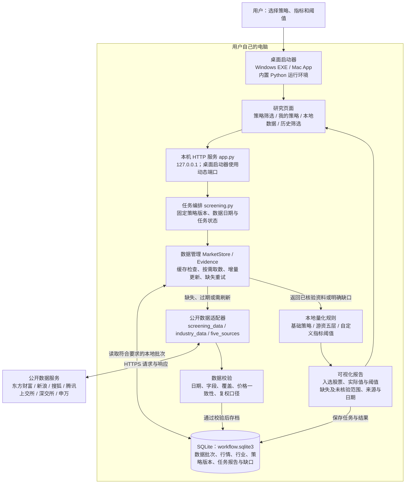
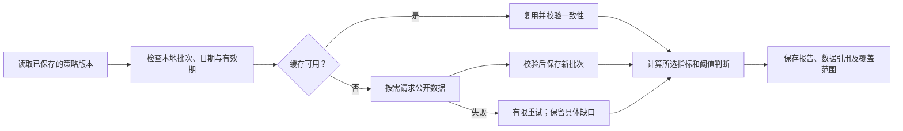

# JoyWorkflow 工具架构与数据获取

Windows x64 和 Mac Apple Silicon 0.5.2 从同一份源码构建。

## 数据如何获得

用户点击“获取数据并运行筛选”，内置 Python 程序通过 HTTPS 请求公开接口，解析 JSON、文本或交易所 XLSX，校验后写入本机 SQLite。用户无需提供 CSV、数据库或 API Key，不经过作者的行情服务器。公开服务仍会收到用户电脑发出的行情请求。

程序包含数据适配器，不预装行情数据库。程序按策略准备资料，并非每次下载全部历史、全部股票的所有数据。当前以沪深 A 股收盘研究为主，不是实时交易行情终端。

| 所需数据 | 当前获取方式 | 用途 |
|---|---|---|
| 沪深行情快照 | 东方财富 `push2.eastmoney.com`；特定连接失败或重定向时改用新浪 `vip.stock.finance.sina.com.cn`、`hq.sinajs.cn` | 价格、涨跌幅、成交额等初筛与市场统计 |
| 个股历史日 K | 东方财富 `push2his.eastmoney.com`；特定失败时使用搜狐 `q.stock.sohu.com` 历史与新浪 `finance.sina.com.cn` 复权因子 | 趋势、放量、突破、波动等计算 |
| 行业分类和行业指数 | 申万研究 `www.swsresearch.com` | 行业映射、共振、相对强弱与连续性 |
| 交易日历和证券名录 | 深交所 `www.szse.cn`、上交所 `query.sse.com.cn` | 交易日对齐、上市时间与证券范围核验 |
| 实际涨跌停价与当日 OHLC | 腾讯 `qt.gtimg.cn` | 涨跌停识别及价格区间核验 |
| 涨停、跌停、炸板、昨日涨停股池 | 东方财富 `push2ex.eastmoney.com` | 五层市场环境与昨日强势反馈 |
| 沪深 300 历史指数 | 搜狐 `q.stock.sohu.com` | 同期基准比较 |
| 公告目录 | 东方财富 `np-anotice-stock.eastmoney.com` | 指定窗口的公告标题风险词检查；不等于阅读全文或完整风险审计 |

主备切换只针对代码允许的故障；不会绕过 403、证书错误或数据结构校验失败，也不会跟随未知重定向。并非上表每类资料都有备用源。公开接口可变更或限流，“自动取数”不代表保证始终取到完整数据。

## 整体架构

Skill 资源与策略配置随应用打包，供资源校验和研究口径使用。当前筛选由 Python 规则代码执行，不调用 AI 模型，也不执行交易。既有其他研究入口中的导入、Tushare 或 AI 配置，不是本页自动公开取数筛选的必需依赖。

## 一次筛选的数据流程

核心资料获取失败时，任务可能直接失败；部分资料或个股缺失时，报告可能为 `PARTIAL`。不能将“未核验”计为不满足阈值，也不能将部分股票通过解读为全市场已完成核验。核验数量上限产生的未核验范围单独列出。

## 为什么历史报告显示 4,984 只有效证券

这是 2026-10-30 历史验证批次的统计，不是固定股票总数，也不是最终入选数。当前五层策略研究范围为沪深 A 股，不含北交所；先排除 ST、退市标记及上市不足 120 个交易日的证券，再检查同日收盘报价、价格与成交额。

该批次合资格名录为 **4,989 只**，其中 **4,984 只有效报价，5 只行情缺口，覆盖约 99.90%**。缺口包括：002827、601326、605258 收盘报价无效；302132、689009 未出现在当时备用行情目录中。两种缺口分别保留，不能简单把全部缺口都说成停牌。

4,984 是市场统计输入范围，后续还要经过行业、个股、价格结构与风险条件筛选。历史核验上限也会形成独立的“未核验”数量。该批次报告为 `PARTIAL`，后续日期的有效证券数应按实际数据重新计算。

## 缓存、增量更新与存储

| 数据 | 当前默认复用条件 |
|---|---|
| 行情快照 | 15 分钟缓存有效期，获取检查日在本机当前日期内，并通过行情日期校验 |
| 个股历史 | 同研究截止日，6 小时有效期，并核对末日涨幅、成交额与快照一致性 |
| 行业分类 | 24 小时有效期；映射覆盖和冲突另行检查 |
| 五层补充资料 | 按资料分别缓存；如限价行情 15 分钟、股池 1 小时、基准及行业指数 6 小时；日历按月份设置 |

这些时间表示“是否允许复用”，不是定时刷新频率。点击筛选时才检查和更新，关闭应用后不会继续每日抓取。

历史日 K 满足增量条件时，回取包含重叠期的新数据，与旧批次逐项核对后合并；来源口径、重叠价格或复权因子变化时重新获取完整窗口。数据批次保留指纹、来源、检查时间和证据；报告引用相应批次。

Windows 默认数据库：`%LOCALAPPDATA%\JoyWorkflow\workflow.sqlite3`。

Mac 默认数据库：`~/Library/Application Support/JoyWorkflow/workflow.sqlite3`。

SQLite 是随应用使用的本地文件，无需用户部署数据库服务。应用目录与用户数据目录分开，替换程序包不会主动覆盖数据库。缓存、策略和报告留在用户电脑，当前不向作者服务器上传，也没有跨设备同步。默认服务只绑定回环地址，手机不能直接访问。

## 异常处理

- 断线、超时、可重试的服务器异常：有限重试，页面记录状态与缺口。
- 证书失败、拒绝访问、结构或日期错误：保留失败原因，不关闭 TLS 校验，不以补零或示例填充。
- “重试缺失数据”：建立关联任务，保留旧报告；符合条件的已完成资料可以复用。
- 缓存失效：重新获取；旧批次可供回看，不作为新日期行情冒充使用。

## 对应代码与相关文档

| 模块 | 职责 |
|---|---|
| `windows_launcher.py` / `desktop_backend.py` | 启动、进程管理、健康检查、桌面取数 TLS 配置 |
| `app.py` / `screen.html` | 本机 API 与研究页面 |
| `screening.py` | 策略版本、任务编排、基础筛选与报告留档 |
| `market_store.py` / `data_recovery.py` | 缓存、校验、增量、重试、缺口 |
| `screening_data.py` / `industry_data.py` / `five_sources.py` | 公开接口适配与数据解析 |
| `five_layer.py` / `five_indicator_library.py` | 五层规则、指标选择与阈值判断 |
| `engine.py` | SQLite 连接与基础持久化 |

[返回 README](../README.md) · [五层指标库](五层指标库.md) · [桌面使用说明](桌面应用使用说明.md) · [手机端方案](手机端方案.md)
